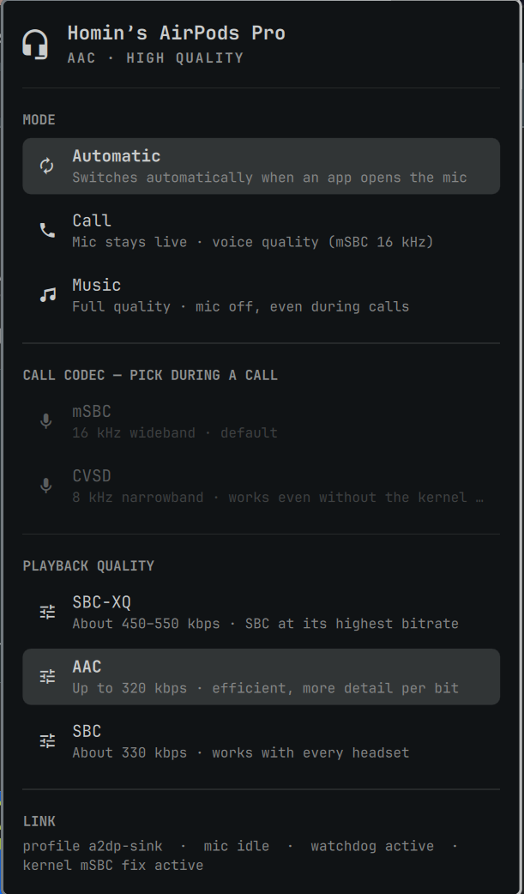

# Bluetooth Headphones

Call/music mode, call codec and playback codec for the Bluetooth headphones
you actually have connected — from the bar. Written for AirPods, because that
is what the trouble started with, but every pair gets the same panel.



## Why this exists

Bluetooth calls are a profile switch, not a volume knob:

- **A2DP** carries music at full quality and has no microphone at all.
- **HFP** carries the microphone and playback on one narrow link.

WirePlumber switches between them whenever an application opens the
microphone. Some controllers — the Apple Broadcom one in an iMac, an Intel
AX201 in a Latitude — do not survive those switches being repeated: the link
drops and the microphone and playback die together. An application that holds
the microphone open (Discord, Chrome) is enough to keep everything at 8 kHz.

This panel makes the state visible and lets you pin it:

| Mode | What it does |
| --- | --- |
| **Automatic** | WirePlumber switches; the bundled watchdog only stops it flapping. |
| **Call** | Forces HFP now, before the application opens the mic. |
| **Music** | Forces A2DP and keeps it there. The microphone is dead until you switch back. |

The links rows also show which application is holding the microphone right
now, so "why is my music muffled" has an answer.

## Call codec and playback codec

- **Call codec** — mSBC (16 kHz wideband) or CVSD (8 kHz narrowband). On an
  Apple Broadcom controller mSBC needs the `btbcm_apple_quirk` kernel module
  (`btbcm-apple-quirk-dkms`). If DKMS does not rebuild after a kernel upgrade,
  mSBC calls go silent while the link looks fine, so the panel reports whether
  the module is loaded and CVSD is one click away.
- **Playback codec** — only what the connected pair negotiated appears: LDAC,
  aptX HD, SBC-XQ, AAC, aptX or SBC. The choice is remembered per pair and
  restored after a call instead of falling back to PipeWire's default.

## Requirements

Everything here ships with Omarchy:

- PipeWire and WirePlumber (`pactl`, `wpctl`, `pw-dump`)
- BlueZ (`bluetoothctl`)
- `python3` and `bash`

Optional, only for wideband mSBC calls on Apple Broadcom controllers:
`btbcm-apple-quirk-dkms`. Without it, calls work on CVSD.

## Install

```bash
omarchy plugin add https://github.com/hominluo/omarchy-airpods --enable
```

That is the whole setup. The bar item appears while a pair of headphones or a
headset is connected and pops the panel open when one connects; it hides
itself otherwise. The watchdog (`bin/bt-call-daemon`) is started by the panel
and stops with the shell, so there is no systemd unit to enable and no script
to copy into `~/.local/bin`.

## Command line

The panel is a thin front end for `bin/bt-call`, which works on its own:

```bash
bin/bt-call info                  # one key=value per line, what the panel reads
bin/bt-call mode auto             # automatic / call / music
bin/bt-call codec                 # this pair's codecs, both profiles
bin/bt-call codec sbc-xq          # pick a playback codec
bin/bt-call codec cvsd            # pick the call codec (during a call)
bin/bt-call status                # info plus a real microphone recording test
bin/bt-call fix [hard]            # recover a stuck link
```

The mode lives in `$XDG_RUNTIME_DIR/bt-call-manual` (absent means automatic),
and per-pair choices live in `~/.local/state/bt-call/`.

With two pairs connected the first PipeWire `bluez_card` wins; set
`BT_CALL_MAC=AA:BB:CC:DD:EE:FF` to pick the other one.

## How the watchdog works

`bin/bt-call-daemon` polls every 2 seconds. When a real application capture
stream is linked to the headset's source, it locks the profile by setting
`bluetooth.autoswitch-to-headset-profile` to false (runtime value only) and
re-pins HFP if something moves it. Twenty seconds after the microphone goes
idle it restores the saved setting and the A2DP profile that was in use before
the call.

Level meters and indicators are ignored on purpose: Omarchy's own bar Peak
Detect opens the microphone for a moment, and counting it as a call would pin
playback at 8 kHz for no reason.

The link is only treated as gone after three unreadable polls, because the
profile is briefly unreadable while SCO tears down — unlocking on a single miss
would create the flapping the watchdog exists to remove.

## Files

| File | Purpose |
| --- | --- |
| `manifest.json` | Plugin manifest: one `bar-widget` entry point |
| `Panel.qml` | Bar item, panel, and the watchdog process |
| `bin/bt-call` | Everything the panel does, plus the diagnostics |
| `bin/bt-call-daemon` | The call watchdog |
| `preview.png` | Marketplace card and README image |

## Uninstall

```bash
omarchy plugin remove io.github.hominluo.airpods
```

The watchdog exits with the shell. Leftovers are only state:
`~/.local/state/bt-call/` and `$XDG_RUNTIME_DIR/bt-call-manual`.

## License

MIT — see [LICENSE](LICENSE).
